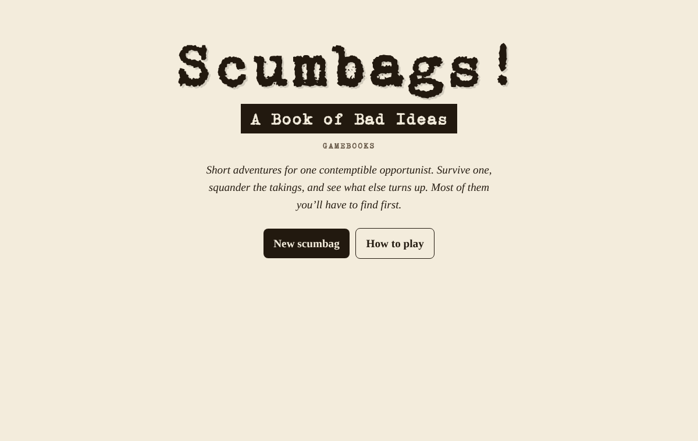
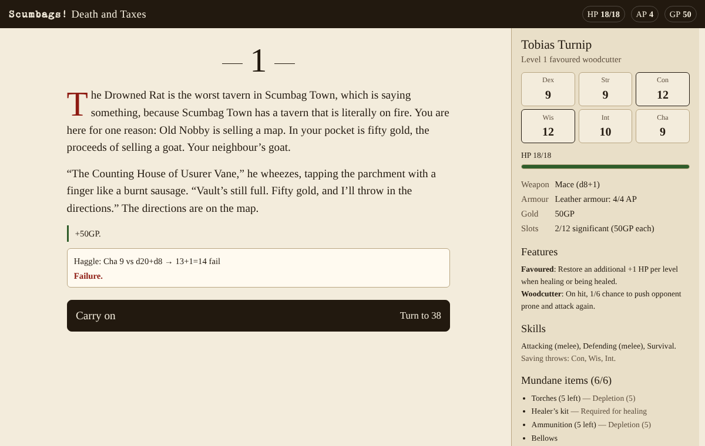

# Scumbags! A Book of Bad Ideas

Classic numbered-section gamebook adventures for one scumbag, played in a browser, using the
rules of the **Scumbags!** tabletop RPG.

**[Play it here](https://sanguinebrah.github.io/scumbags-gamebook/)**, or download
`dist/gamebook.html` and open it. It's a single file with no dependencies and works offline,
on a desktop or a phone.

## The game

You are a scumbag: a contemptible opportunist in search of riches. Roll up a character from
the rulebook's tables, read the numbered sections, choose what to do, and test your stats when
things get dicey. Fights, light, spells, loot and levelling all follow the Scumbags! rules:

- Stat tests roll under your stat on a d20 plus a difficulty die. Skilled tests roll twice and
  keep the better result, and your profession decides when you're skilled.
- Melee attacks are tested against a d8 and ranged attacks against a die for the distance. You
  defend with Str or Dex against the monster's die. Armour soaks damage before your HP.
- Dark places use up torches and oil. Every 50 gold takes up an item slot.
- You level up by squandering 200 gold on a pointless endeavour when you get home.

Nearly everything in your pack is useful somewhere. A rope, a rat or a pot of glue will often
get you past things a sword won't.

## Adventures

Each adventure is a short, self-contained job. Survivors return to Scumbag Town, where they can
heal, restock, buy and sell, and squander their takings. Finishing one job reveals new ones on
the notice board. Nobody gets to do the same job twice, and later adventures remember what you
did in earlier ones.

| Adventure | Level | The job |
|---|---|---|
| Death and Taxes | 1 | Rob a dead moneylender's vault under Gallows Hill |
| The Tall Order | 1–2 | Steal the Lofty Hat from Lord Longshanks' birthday party |
| Fortune's Fang | 2–3 | Break the bank at a casino run by a luck vampire |
| Mother's Kitchen | 3–4 | Steal a hill giant's prize Golden Turnip from her mantelpiece |
| Eviction Notice | 4–5 | Evict a kobold siege-pyramid from a town square, or don't |
| The Last Ride of Sir Gristle | 5–6 | Get a dying old knight to his glorious last battle, or keep him alive |
| The Invisible Menagerie | 6–7 | Steal an invisible ostrich egg from a travelling show |
| Unsolved | 7–8 | Solve the transdimensional murdercube haunting a university |
| Torches and Pitchforks | 8–9 | Escort Lord Grimsby across a moor through a mob of ghostly tenants |
| A Perfectly Standard Dragon | 9–10 | Deal with a dragon that is following procedure |

Sections are shuffled the traditional way: the start is 1 and the way home is last. Progress
and surviving scumbags are saved in your browser.

## Building and developing

Needs Node 20 or later. There are no dependencies to install.

    npm run build      # writes dist/gamebook.html: one self-contained file
    npm run serve      # dev server on http://localhost:8080, straight from src/
    npm test           # rules, engine and bot playthroughs
    npm run check      # every adventure: missing targets, unreachable sections, dead ends, unknown names
    npm run simulate   # thousands of bot playthroughs: survival rates and deadly sections
    npm run duels      # every fight in the book, from full health, by random bots

Two more tools help when writing:

    node tools/affordances.mjs   # which items, spells and professions each adventure gives a use to
    node tools/states.mjs <id>   # the flags that may or may not be set on arrival at each section

| Path | What's in it |
|---|---|
| `src/rules/` | Rulebook tables and rules: dice, stat tests, character creation, levelling |
| `src/engine/` | Gamebook engine: sections, choices, conditions, effects, fights, the town, saving |
| `src/adventure/` | One module per adventure, and `index.js`, which registers, unlocks and numbers them |
| `src/ui/app.js` | The whole interface, in plain DOM |
| `index.html` | Page shell and all the CSS |
| `tools/` | Bundler, dev server, checker, bots and writing aids |
| `docs/ADAPTATION.md` | Where and why the gamebook departs from the tabletop rules |
| `docs/WRITING.md` | How to write sections and adventures |

Pushing to `main` runs the tests and publishes the built gamebook to GitHub Pages.

## Licence

© 2018–2026 SanguineBrah. Licensed under
[Creative Commons Attribution-NonCommercial 4.0](https://creativecommons.org/licenses/by-nc/4.0/):
you can share and adapt it, with credit, but not for commercial purposes. See `LICENSE`.

The title font is [GNU Typewriter](http://www.komsta.net) by Łukasz Komsta,
under the SIL Open Font License 1.1 (`assets/OFL.txt`).
