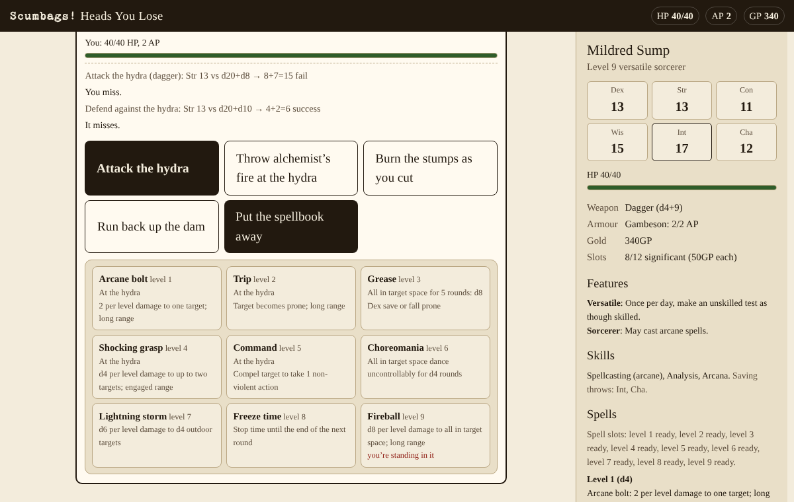
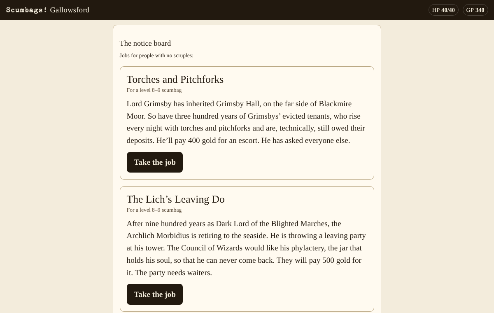
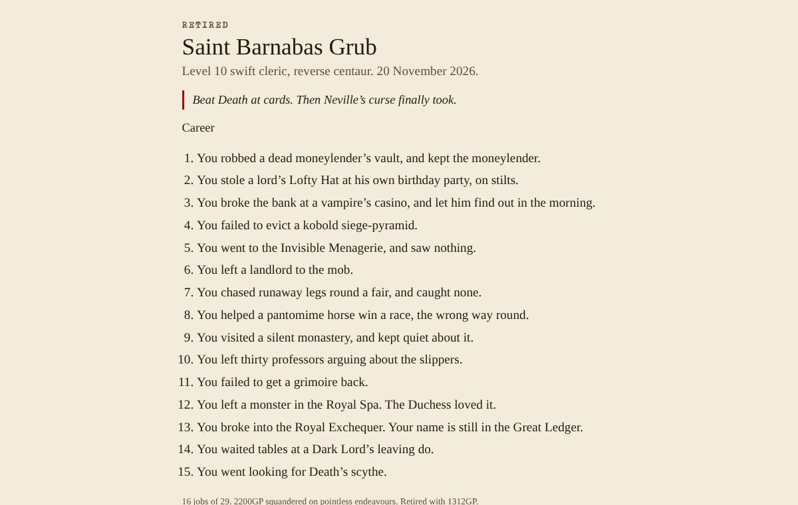

# Scumbags! A Book of Bad Ideas

Classic numbered-section gamebook adventures for one scumbag, played in a browser, using the
rules of the **Scumbags!** tabletop RPG.

**[Play it here](https://sanguinebrah.github.io/scumbags-gamebook/)**, or download
`dist/gamebook.html` and open it. It's a single file with no dependencies and works offline,
on a desktop or a phone.

## The rulebook

The full Scumbags! tabletop rulebook, version 2.0, is in
[`rulebook/Scumbags-rulebook-v2.0.pdf`](rulebook/Scumbags-rulebook-v2.0.pdf): a 20-page A5
booklet with everything you need to run the game with a host and a group of players.

## The game

You are a scumbag: a contemptible opportunist in search of riches. Roll up a character from
the rulebook's tables, read the numbered sections, choose what to do, and test your stats when
things get dicey. Fights, light, spells, loot and levelling all follow the Scumbags! rules:

- Stat tests roll under your stat on a d20 plus a difficulty die. Skilled tests roll twice and
  keep the better result, and your profession decides when you're skilled.
- Melee attacks usually use a d8 difficulty die, and ranged attacks a die for the distance. You
  defend with Str or Dex against the monster's die. Armour soaks damage before your HP.
- Dark places use up torches and oil. Every 50 gold takes up a significant item slot.
- Magicians get a spell slot at every level and the rulebook's whole spell list, from Divine light
  to Wish, in and out of fights. When a divine spell goes critically wrong, your god casts the
  opposite one instead.
- You level up by squandering 200 gold on a pointless endeavour when you get home.

Nearly everything in your pack is useful somewhere. A rope, a rat or a pot of glue will often
get you past things a sword won't.

In a fight, every action is a button. Spells live in a spellbook you open when you need it, with
each one marked with what it will hit, or why it's a bad idea.

## Adventures

Each adventure is a short, self-contained job. Survivors return to Gallowsford, where they can
heal, restock, buy and sell, and squander their takings. Finishing any job in a level band
reveals every job in the next band on the notice board, so after the first job there's always a
choice. Nobody gets to do the same job twice, and later adventures remember what you did in
earlier ones: the people you robbed, rescued or annoyed turn up again. Scumbags who are
over-qualified for a job get paid less for it, so going back for the easy ones won't make you rich.

Finish a job at the top level and the last job turns up, where the career ends, one way or
another. Scumbags who pay attention may find it isn't the only one. Retire in town before then if
you'd rather. Either way, you get a write-up of everything you did, kept on the title page.

| Band | Adventure | Level | The job |
|---|---|---|---|
| 1 | Death and Taxes | 1 | Rob a dead moneylender's vault under Gallows Hill |
| 2 | The Tall Order | 1–2 | Steal the Lofty Hat from Lord Longshanks' birthday party |
| 2 | Legging It | 1–2 | Round up forty pairs of animated legs at a village fair |
| 2 | Bath Night | 1–2 | Get a filthy lord into a bath before his wedding |
| 3 | Fortune's Fang | 2–3 | Break the bank at a casino run by a luck vampire |
| 3 | The Wrong Way Round | 2–3 | Fix a horse race with a reverse centaur in it |
| 3 | Now You See Him | 2–3 | Catch a champion blink dog before the judging |
| 4 | Mother's Kitchen | 3–4 | Steal a hill giant's prize Golden Turnip from her mantelpiece |
| 4 | Vow of Silence | 3–4 | Steal a liqueur recipe from an abbey where nobody may make a sound |
| 4 | Knightmare | 3–4 | Get a riderless warhorse out of the tournament it keeps winning |
| 5 | Eviction Notice | 4–5 | Evict a kobold siege-pyramid from a town square, or don't |
| 5 | Splitting Heirs | 4–5 | Find the real alchemist among thirty copies of him |
| 5 | Going Bananas | 4–5 | Deal with a runaway golem made of bananas |
| 6 | The Last Ride of Sir Gristle | 5–6 | Get a dying old knight to his glorious last battle, or keep him alive |
| 6 | Detention | 5–6 | Get a stolen grimoire back from a gang of delinquent wizards |
| 6 | Out of the Cot | 5–6 | Get a hill giant's baby home before the giant-catcher gets it |
| 7 | The Invisible Menagerie | 6–7 | Steal an invisible ostrich egg from a travelling show |
| 7 | Taking the Waters | 6–7 | Get a giant blob out of a fashionable spa |
| 7 | Trial by Ducking | 6–7 | Save an old herbalist from a witchfinder before dawn |
| 8 | Unsolved | 7–8 | Solve the transdimensional murdercube haunting a university |
| 8 | Death and More Taxes | 7–8 | Break into the Royal Exchequer to get your name out of the Great Ledger |
| 8 | The Clockwork Cathedral | 7–8 | Stop a mechanical bishop before the Archbishop arrives |
| 9 | Torches and Pitchforks | 8–9 | Escort Lord Grimsby across a moor through a mob of ghostly tenants |
| 9 | The Lich's Leaving Do | 8–9 | Steal an archlich's soul at his retirement party |
| 9 | Heads You Lose | 8–9 | Get a hydra out of a town's reservoir without making it bigger |
| 10 | A Perfectly Standard Dragon | 9–10 | Deal with a dragon that is following procedure |
| 10 | Death Takes a Holiday | 9–10 | Find Death's stolen scythe at the seaside |
| 10 | Higher Still | 9–10 | Rescue Lord Longshanks from the cloud giants above his spire |
| 11 | Final Demand | 10 | Death and the taxman come to collect, back where it all began |

Sections are shuffled the traditional way: the start is 1 and the way home is last. Progress
and surviving scumbags are saved in your browser.

## Building and developing

Needs Node 20 or later. There are no dependencies to install.

    npm run build      # writes dist/gamebook.html: one self-contained file
    npm run serve      # dev server on http://localhost:8080, straight from src/
    npm test           # rules, engine and bot playthroughs
    npm run check      # every adventure: missing targets, unreachable sections, dead ends, unknown names
    npm run simulate   # thousands of bot playthroughs: survival rates and deadly sections
    npm run duels      # every fight in the book, from full health, by random bots

A few more tools help with writing and balance:

    node tools/affordances.mjs   # which items, spells and professions each adventure gives a use to
    node tools/states.mjs <id>   # the flags that may or may not be set on arrival at each section
    node tools/campaign.mjs      # whole careers played by bots: levels, gold and deaths by band

| Path | What's in it |
|---|---|
| `src/rules/` | Rulebook tables and rules: dice, stat tests, character creation, levelling |
| `src/engine/` | Gamebook engine: sections, choices, conditions, effects, fights, the town, saving |
| `src/adventure/` | One module per adventure, and `index.js`, which registers, unlocks and numbers them |
| `src/ui/app.js` | The whole interface, in plain DOM |
| `index.html` | Page shell and all the CSS |
| `tools/` | Bundler, dev server, checker, bots and writing aids |
| `docs/ADAPTATION.md` | Where and why the gamebook departs from the tabletop rules |
| `docs/WRITING.md` | How to write sections and adventures |
| `rulebook/` | The tabletop rulebook, as a PDF |

Pushing to `main` runs the tests and publishes the built gamebook to GitHub Pages.

## Licence

© 2018–2026 SanguineBrah. Licensed under
[Creative Commons Attribution-NonCommercial 4.0](https://creativecommons.org/licenses/by-nc/4.0/):
you can share and adapt it, with credit, but not for commercial purposes. See `LICENSE`.

The title font is [GNU Typewriter](http://www.komsta.net) by Łukasz Komsta,
under the SIL Open Font License 1.1 (`assets/OFL.txt`).
